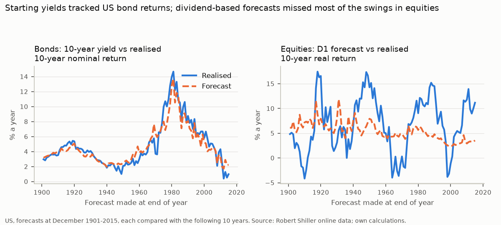

# Capital market assumptions

Generated by `make all` from `reports/cma_figures.json`; do not edit by hand. Rules: `docs/decisions.md` (2026-10-28), fixed before any result was computed. As-of date: 2026-09-30. All figures are annualised 10-year **real** returns at index level, before fund costs (costs are deducted in the simulation).

## Headline

1. **Starting yields forecast bond returns well, largely by construction.** The 10-year yield at the start explained most of the variation in the next 10 years' nominal bond return: out-of-sample R² 0.91 in the US (1901–2015) and 0.78 pooled across 16 JST countries (positive in 16 of 16). This is mostly arithmetic, not forecasting skill: when a bond's duration is close to the horizon, gains and losses from yield changes are largely offset by reinvesting at the new yield, so the holding-period return stays close to the starting yield. The US test is also partly circular: Shiller's realised bond returns are themselves computed from the same 10-year yield series (they match a 10-year par bond repriced at each month's yield, checked 2026-10-28). It says nothing about the path in between, which the simulation handles separately.
2. **Equity methods add little over the long-run mean internationally.** Across 16 JST countries, dividend yield plus real dividend growth (D1) had a pooled out-of-sample R² of 0.004 [95% interval -0.16 to 0.14]: no better than assuming the historical average return. It was positive in 9 of 16 countries (median 0.12; best Australia 0.33, worst Denmark -0.74). In the US it was 0.09 [-0.17, 0.33].
3. **The best US equity predictor can't be used going forward with free data.** 1/CAPE (E3) did best in the US: R² 0.31 [0.18, 0.47], the only equity interval that excludes zero. The fund factsheet publishes no CAPE (only a forward, analyst-estimate P/E), so E3 stays validation-only. It is not substituted after seeing these results.

## Scenarios used by the simulation

Each scenario is simulated separately (never drawn at random on top of the return bootstrap). Low and high = central ∓ the wider of (a) the method spread and (b) the bootstrap standard error of the central estimate. **These ranges describe uncertainty about the expected return, not the range of outcomes:** a single 10-year outcome has historically missed its forecast by far more (RMSE 7.7% for D1 across JST countries). The spread of outcomes comes from the simulation, and failed validation tests are reported below rather than built into these ranges.

| Asset class | Low | Central | High | (a) method spread | (b) bootstrap s.e. | Width set by |
|---|---|---|---|---|---|---|
| Global equities (SGD, unhedged) | 1.4% | **2.4%** | 3.4% | 0.66% | 1.04% | (b) bootstrap standard error |
| Singapore Government Securities | 0.2% | **0.7%** | 1.2% | 0.17% | 0.50% | (b) bootstrap standard error |
| SGD cash | -0.5% | **-0.1%** | 0.3% | 0.00% | 0.37% | (b) bootstrap standard error |
| Singapore CPI inflation | 1.2% | **1.7%** | 2.2% | 0.00% | 0.50% | (b) bootstrap standard error |

- **Equities:** central = D1. The method spread compares D1 with E1 (the US-growth variant); E1 contributes to the spread only, because applying US earnings growth to a global index yield biases the estimate upward.
- **SGS:** central = B1 (starting yield). The spread compares B1 with B2 (B1 plus rolldown); B2 is not central because it lost to B1 on US out-of-sample RMSE (1.41% vs 1.27%).
- **Cash and inflation:** one method each, so the bootstrap standard error sets the width.
- **Equity standard error:** resamples the same blocks of calendar years for every country (amendment 4), so common shocks move all countries together.

**Post-hoc sensitivities (not used; central unchanged):**
- P1, real dividend growth from each country's longest run of 30+ years: median 0.49% across 16 countries (adds Portugal), giving D1 of 2.06%.
- P2, D1 corrected for its pooled JST out-of-sample bias (-0.8 pp): 3.21%.

## Assumptions and their sources

**Inflation:** 1.71% a year: annualised Singapore CPI (All Items) inflation, 1996-2025 (SingStat table M213751).

**Global equities (SGD, unhedged)**

| Component | Value | Source |
|---|---|---|
| Index dividend yield | 1.57% | ACWD factsheet, 30 September 2026, page 2 (`reference/fund_documents.csv`) |
| Real dividend growth (D1) | 0.83% | Median of 15 JST countries' real dividend growth, contiguous runs of 30+ years ending 2015 with positive dividends at both ends |
| Real EPS growth (E1, spread only) | 2.16% | Shiller US real EPS, 1871-01 to 2026-06 |
| Expected real change in SGD | 0.0% | Relative purchasing power parity (Rogoff 1996 still to verify). Measured real SGD change against the USD: -0.08% (1981-2025), -0.49% (1995-2025), +0.93% (2005-2025) a year (positive = SGD appreciation; FRED EXSIUS, US and Singapore CPI). Near zero over the longest window but sensitive to the window, and USD-only while the fund holds many currencies |
| **D1 = central** | **2.40%** | |
| E1 | 3.73% | |

Checks, not used: real GDP per capita growth, median of 18 JST countries to 2015: 1.77%. Forward earnings yield (1 / P/E FY1 of 23.84): 4.19%, nominal and **based on analyst estimates** of next year's earnings.

Real dividend growth by country (D1 input):

| Country | Real dividend growth |
|---|---|
| France | -3.10% |
| Italy | -1.98% |
| Belgium | -0.89% |
| Germany | -0.82% |
| Norway | -0.46% |
| Spain | -0.19% |
| Finland | 0.16% |
| UK | 0.83% |
| Denmark | 1.15% |
| USA | 1.48% |
| Sweden | 1.50% |
| Netherlands | 1.78% |
| Australia | 1.87% |
| Switzerland | 3.92% |
| Japan | 5.36% |

**SGS:** the yield at 8.18 years (the duration of the SGS fund used in `Multi-Asset-Allocation`) interpolated between the 5-year (2.24%) and 10-year (2.47%) benchmark yields on 2026-09-30: 2.39% nominal, 0.68% real (B1). Rolldown adds 0.33% (B2, spread only).

**SGD cash:** the 3-month compounded SORA at the end of September 2026 (1.23% nominal, -0.48% real) moving in a straight line to the long-run real 3-month rate (0.25%, 1988-2025: interbank to 2013, then compounded SORA); the 10-year average is -0.11%.

## Validation results

All forecasts use only data available at each origin (expanding windows, 30-year burn-in, a 3-month publication lag on Shiller dividends, earnings and CPI). Each is compared with the realised return over the next 10 years and with the historical-mean forecast (out-of-sample R², Campbell & Thompson 2008). Weak results are reported as found (Goyal & Welch 2008). Effective n = origins / 10, because 10-year windows overlap. R² intervals: moving-block bootstrap, blocks of 10 origins, 2,000 replications, seed 20261028.

| Method | Sample | Basis | Origins | Effective n | Bias (HAC s.e.) | RMSE | Correlation | OOS R² [95% interval] |
|---|---|---|---|---|---|---|---|---|
| E1 | Shiller US | real | 1901–2015 (115) | 11.5 | -1.1 pp (1.2%) | 5.5% | 0.23 | 0.12 [-0.11, 0.34] |
| E2 | Shiller US | real | 1901–2015 (115) | 11.5 | -1.0 pp (1.6%) | 6.2% | 0.41 | -0.10 [-0.59, 0.40] |
| E3 | Shiller US | real | 1901–2015 (115) | 11.5 | +0.5 pp (1.2%) | 4.9% | 0.49 | 0.31 [0.18, 0.47] |
| D1 | Shiller US | real | 1901–2015 (115) | 11.5 | -1.3 pp (1.3%) | 5.6% | 0.19 | 0.09 [-0.17, 0.33] |
| B1 | Shiller US | nominal | 1901–2015 (115) | 11.5 | -0.2 pp (0.2%) | 1.0% | 0.96 | 0.91 [0.73, 0.95] |
| B1 | Shiller US, B2 origins | nominal | 1953–2015 (63) | 6.3 | -0.2 pp (0.3%) | 1.3% | 0.95 | 0.91 [0.69, 0.95] |
| B2 | Shiller US, B2 origins | nominal | 1953–2015 (63) | 6.3 | +0.3 pp (0.4%) | 1.4% | 0.94 | 0.89 [0.60, 0.96] |
| D1 | JST pooled | real | 1900–2005 (1341) | 10.6 | -0.8 pp (1.3%) | 7.7% | 0.15 | 0.004 [-0.16, 0.14] |
| B1 | JST pooled | nominal | 1900–2005 (1290) | 10.6 | +0.1 pp (0.3%) | 2.1% | 0.86 | 0.78 [0.48, 0.88] |

Equity rows are real returns; bond rows are nominal (amendment 3). JST data ends in 2015 (amendment 1); Canada and Ireland have no equity data in JST R6. Per-country results: `data/processed/cma_validation_by_country.csv`.

**Where the methods fail:**
- E2 (E1 plus CAPE reversion) did worse than the historical mean in the US (R² -0.10).
- D1 is negative in 7 of 16 JST countries.
- Every equity method has a wide R² interval: with about 12 independent 10-year periods in the US, the data can't separate weak predictors from none.
- D1 forecasts were too low on average (bias -1.3 pp US, -0.8 pp JST pooled), as were E1 (-1.1 pp) and E2 (-1.0 pp); E3's bias was positive (+0.5 pp). Each is within about one standard error of zero.

## Known biases and limits of these estimates

- **Buybacks are left out, so the equity central is probably too low.** D1's forward input is the dividend yield only. Companies also return cash through share buybacks: for the S&P 500 in 2025, Damodaran's data give a dividend yield of 1.15% and a gross buyback yield of 1.76% (gross: not net of share issuance; no free, citable net series was found). This is consistent with the negative validation bias of D1, E1 and E2. It is disclosed, not corrected: no buyback adjustment was registered. P2 above shows the size of a bias correction.
- **Which countries feed dividend growth.** All 15 are developed markets with long, continuous data: a sample of markets that came through their crises, not a random draw. JST has no emerging markets, while the fund holds some. Excluded: Portugal (no contiguous run of 30+ years ending in 2015 with positive dividends at both ends); Canada (no equity data in JST R6); Ireland (no equity data in JST R6). P1 shows the effect of using each country's longest run instead.
- **US data are revised, and the lag is a judgement.** Shiller's file is today's revised history, not what investors could see at the time, and the 3-month lag on dividends, earnings and CPI is Evidence: pending. This affects the US validation (E1–E3, D1), not the forward estimates.

## Comparison with other estimates

| Estimate | Equities, real | Bonds, real | Cash/bills, real |
|---|---|---|---|
| This project, central (SGD) | 2.4% | 0.7% | -0.1% |
| `Multi-Asset-Allocation`, historical global JST portfolio (100% / 0% equity)¹ | 6.3% | 3.4% | – |
| Philadelphia Fed SPF, 2026Q1 median 10-year forecasts (US, less CPI10 2.3%) | 4.7% | 1.7% | 0.7% |
| Damodaran implied ERP (2025) + T-bond rate, less the same CPI10 | 6.1% | – | – |

¹ Computed in `Multi-Asset-Allocation` from JST data to 2020, including the 2016–2020 years this project excludes (amendment 1).

**Why the forward equity figure is below the historical one:** most of the gap is the starting yield. The index dividend yield today is 1.57%; the median JST dividend yield over 1870–2015 was 4.10%. A building-block estimate passes today's low yield straight through; a historical average assumes the past's higher yields recur. The US survey and implied-premium figures are for US assets in USD and are shown for context only.

**Near-term inflation cross-check (MAS Survey of Professional Forecasters):** Pending: the workbook must be saved by hand (MAS returns a web page, not the file, to scripted requests), so no figure is shown yet. Source: MAS, *Survey of Professional Forecasters*, September 2026 results workbook (`sep26q3.xlsx`). Contains information from the MAS Survey of Professional Forecasters, which is made available under the terms of the Monetary Authority of Singapore's Terms of Use of Datasets.

## Sources and licences

- Robert Shiller, online data (`ie_data.xls`): no licence stated; only derived figures are shown.
- Jordà-Schularick-Taylor Macrohistory Database R6; Jordà et al. (2019), *QJE* 134(3). JST-derived figures are licensed CC BY-NC-SA 4.0.
- MAS domestic interest rates and SGS benchmark yields: contains information from MAS statistics, made available under the terms of the Monetary Authority of Singapore's Terms of Use of Datasets.
- SingStat table M213751 (CPI): terms not confirmed; only derived figures are shown.
- Philadelphia Fed Survey of Professional Forecasters (STOCK10, BOND10, BILL10, CPI10 medians); Damodaran, `histimpl.xls`: cited figures only.
- FRED GS5, GS10: public domain.
- ACWD factsheet (30 September 2026) and SSGA SPDR ETFs Europe I plc annual report (year to 31 March 2026): cited by page; not redistributed.
- Citations with DOIs: `reference/citations.csv`.
