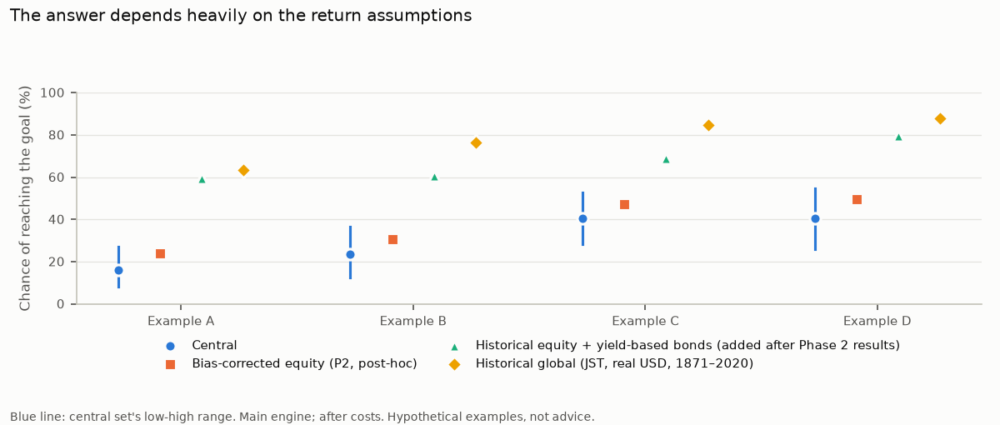
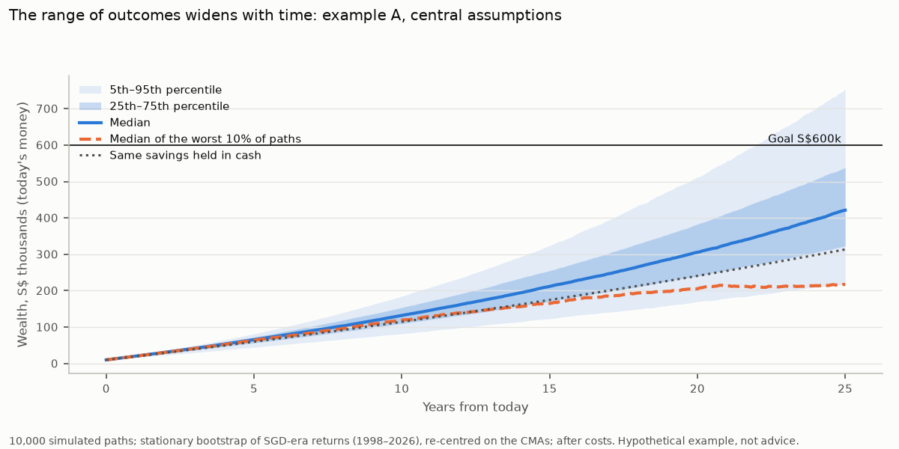

# Simulation results (Phase 2)

Generated by `make all` from `reports/simulation_figures.json`; do not edit by hand. Rules: `docs/decisions.md` (2026-10-28, Phase 2 pre-registration). Most rules were fixed before any simulation; later changes are labelled post-hoc, including the historical equity + yield-based bonds set, added after the Phase 2 results. **Hypothetical examples for education, not advice.** All amounts are in today's Singapore dollars (real), after fund costs and trading costs.

## How it works

- 10,000 simulated monthly paths per case, seed 20261028. Monthly real returns are resampled from history in random-length blocks (stationary bootstrap, Politis & Romano 1994; mean block 24 months), then shifted so each asset's long-run compound return equals the assumption being tested.
- **Main history:** SGD-era returns, 1998-07 to 2026-09 (339 months): developed-market equities converted to SGD, and a constant 8.18-year SGS bond, both after Singapore inflation. This supplies the ups and downs (volatility, crashes, how shares and bonds move together), not the average return.
- The portfolio is rebalanced monthly. Costs: an all-in holding cost of 0.29% to 0.32% a year depending on the mix (fund fees, withholding tax inside the equity fund, rebalancing), plus each purchase's actual broker, exchange, currency and spread costs, including minimum fees.
- The examples' share mixes are `Multi-Asset-Allocation`'s risk-menu mixes (59% the binding menu mix; 49%, 67% and 88% its SGD-era sensitivity mixes). **They are not age-based advice.**

## Chance of reaching the goal

**There is no single headline probability.** The headline is the chance under each assumption set, side by side. Assumption choice moves the result far more than the engine or market randomness: across the three plausible sets (central, bias-corrected equity, historical equity + yield-based bonds) the chance differs by 28–44 percentage points depending on the example, against 3–9 points across the five engines (central assumptions) and at most ±0.5 points of simulation sampling noise (one standard error with 10,000 paths). Including the historical global reference set, the spread is larger: 44–53 points.

| Example | Age | Saving | Years | Goal | Equity share | Central (low–high) | Bias-corrected equity (P2) | Historical equity + yield-based bonds | Historical global (reference) |
|---|---|---|---|---|---|---|---|---|---|
| A | 30 | S$10,000 + S$800/month (+2% a year) | 25 | S$600,000 | 88% | **16%** (8%–27%) | **24%** | **60%** | 63% |
| B | 45 | S$150,000 + S$1,500/month | 15 | S$600,000 | 59% | **23%** (13%–36%) | **31%** | **61%** | 76% |
| C | 55 | S$400,000 + S$0/month | 10 | S$500,000 | 49% | **41%** (28%–53%) | **47%** | **69%** | 85% |
| D | 40 | S$0 + S$1,275/month (shown without SRS; with SRS below) | 24 | S$500,000 | 67% | **40%** (26%–55%) | **49%** | **80%** | 88% |

What the sets assume (real, a year): central equities 2.4%, SGS 0.7%; P2 equities 3.2% with central SGS; historical equity + yield-based bonds: historical global equities 6.3% with the forward SGS (0.7%) and cash assumptions, because starting yields forecast bond returns well (`docs/cma.md`); historical global equities 6.3%, bonds 3.4%, kept as a reference. **The historical bond figure is a global JST bond return (real USD, 1871–2020), not a historical SGS return:** it is 2.7% a year above the SGS forward assumption, because today's SGS starting yield is low relative to the average real return of developed-market bonds over 1871–2020, a period that includes 1981–2020's long fall in yields.

**What "chance of reaching the goal" means:** the share of the 10,000 simulated futures in which wealth at the goal date is at least the goal. It is only as good as the assumptions behind it, which is why three sets are shown.

## The range of outcomes (central assumptions)

| Example | Total saved | Wealth at goal date: 10th percentile | Median | 90th percentile | Typical largest fall | Largest fall, worst 5% of paths |
|---|---|---|---|---|---|---|
| A | S$317,491 | S$252,912 | S$421,193 | S$665,362 | -52% | -73% |
| B | S$420,000 | S$361,938 | S$507,811 | S$675,463 | -28% | -50% |
| C | S$400,000 | S$336,774 | S$472,903 | S$622,905 | -22% | -40% |
| D | S$367,200 | S$314,927 | S$465,021 | S$660,436 | -41% | -61% |

**Why outcomes spread, and why the fan widens with time:** returns vary from month to month, and good or bad stretches compound. The longer the horizon, the more these stretches accumulate, so the gap between good and bad outcomes grows. The orange line follows the median of the worst 10% of futures; the dotted line shows the same savings held in cash.

**Largest fall** is the biggest peak-to-trough drop in the portfolio's value (ignoring new savings) at any point along a path, after inflation. It shows how deep a slump an investor would have had to sit through.

## Monthly saving needed for a chosen chance

The smallest monthly amount (to S$10) that reaches the goal with the stated probability, holding the initial amount, growth and horizon fixed.

| Example | Assumptions | 50% chance | 75% chance | 90% chance |
|---|---|---|---|---|
| A | Central | S$1,150 | S$1,510 | S$1,930 |
| A | Bias-corrected equity (P2, post-hoc) | S$1,050 | S$1,390 | S$1,780 |
| A | Historical equity + yield-based bonds (added after Phase 2 results) | S$720 | S$980 | S$1,290 |
| A | Historical global (JST, real USD, 1871–2020) | S$690 | S$940 | S$1,230 |
| B | Central | S$1,940 | S$2,460 | S$3,000 |
| B | Bias-corrected equity (P2, post-hoc) | S$1,810 | S$2,310 | S$2,850 |
| B | Historical equity + yield-based bonds (added after Phase 2 results) | S$1,330 | S$1,790 | S$2,290 |
| B | Historical global (JST, real USD, 1871–2020) | S$1,040 | S$1,480 | S$1,960 |
| C | Central | S$220 | S$880 | S$1,490 |
| C | Bias-corrected equity (P2, post-hoc) | S$80 | S$730 | S$1,340 |
| C | Historical equity + yield-based bonds (added after Phase 2 results) | S$0 | S$190 | S$800 |
| C | Historical global (JST, real USD, 1871–2020) | S$0 | S$0 | S$300 |
| D | Central | S$1,380 | S$1,680 | S$2,020 |
| D | Bias-corrected equity (P2, post-hoc) | S$1,290 | S$1,570 | S$1,900 |
| D | Historical equity + yield-based bonds (added after Phase 2 results) | S$990 | S$1,220 | S$1,490 |
| D | Historical global (JST, real USD, 1871–2020) | S$870 | S$1,080 | S$1,330 |

## How much the engine matters (central assumptions)

| Engine | Mean block or df | Example A | Example B | Example C | Example D |
|---|---|---|---|---|---|
| Bootstrap, SGD era, 24-month blocks (main) | 24 months | 16% | 23% | 41% | 40% |
| Bootstrap, US 1871-, 24-month blocks | 24 months | 20% | 28% | 42% | 41% |
| Student-t, SGD era | fitted df 5.5 | 15% | 23% | 38% | 38% |
| Bootstrap, SGD era, n^(1/3) blocks | 7 months | 19% | 25% | 40% | 40% |
| Bootstrap, SGD era, 60-month blocks | 60 months | 12% | 20% | 40% | 38% |

The Student-t draws are independent month to month: fat tails, but no clustering of bad months. The US long-run history has no currency risk and uses a modelled bond.

## Investing monthly or quarterly (central assumptions)

Minimum broker fees make small purchases expensive; batching three months into one purchase reduces them.

| Example | Trading costs, monthly purchases (median total) | Quarterly purchases | Chance, monthly | Chance, quarterly |
|---|---|---|---|---|
| A | S$3,454 | S$1,286 | 16% | 16% |
| B | S$2,399 | S$1,097 | 23% | 24% |
| D | S$3,407 | S$1,325 | 40% | 41% |

## SRS (example D, simplified)

Example D saves the citizen cap through SRS. Any saving above the cap would be invested in the same mix outside SRS. Tax relief at a 11.5% marginal rate is a tax saving, not an SRS contribution, so it is invested outside SRS a year after each contribution (the final year's relief counts at the goal date). From the goal date (age 64, the statutory retirement age for a first contribution from 1 July 2026) both balances stay invested and are withdrawn over 10 years; half of each SRS withdrawal is taxed at IRAS resident rates with no other income. The comparison invests the same saving outside SRS (no relief, no withdrawal tax) and withdraws on the same schedule.

| Assumptions | Total relief reinvested | After-tax withdrawals, SRS (median) | Withdrawals without SRS (median) | Tax paid (median) | Paths where SRS comes out ahead |
|---|---|---|---|---|---|
| Central | S$42,228 | S$561,225 | S$508,681 | S$1,124 | 100% |
| Bias-corrected equity (P2, post-hoc) | S$42,228 | S$615,483 | S$558,490 | S$1,701 | 100% |
| Historical equity + yield-based bonds (added after Phase 2 results) | S$42,228 | S$877,009 | S$800,645 | S$6,516 | 100% |
| Historical global (JST, real USD, 1871–2020) | S$42,228 | S$1,031,654 | S$945,974 | S$10,948 | 100% |

**The comparison doesn't value the loss of access:** money in SRS can't be withdrawn before the statutory retirement age without full tax and a 5% penalty, while money outside SRS can be used at any time. That flexibility has value the table leaves out.

Simplifications: the S$80,000 overall relief cap is assumed not to bind; tax brackets and fee minimums are held constant in today's money; withdrawing before the statutory retirement age taxes the whole SRS balance as income at IRAS resident rates on top of other income, plus a 5% penalty (the app will warn when the goal date is earlier).

## Limits

- The equity central leaves out buybacks and is probably too low (`docs/cma.md`); P2 shows a bias-corrected alternative.
- The historical equity figure (6.3%) comes from developed markets that came through their crises (a survivor sample), so the two historical sets probably overstate what a random market would have returned.
- The SGD-era history is short (339 months) and starts in 1998-07 because MAS's 10-year SGS benchmark begins in June 1998; developed markets only (no emerging markets).
- The ACWD spread is a default (0.10%), not measured; the fee schedules are one broker pair's published rates, used as cost data, not a recommendation.
- Taxes outside SRS, behaviour (stopping contributions after a fall) and changes in circumstances are not modelled.

*Contains information from MAS statistics (available from mas.gov.sg), made available under the terms of the Monetary Authority of Singapore's Terms of Use of Datasets. JST-derived figures are licensed CC BY-NC-SA 4.0.*
